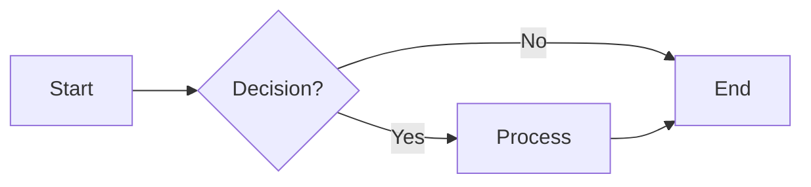

# Victor's Project

## Student ID: 202384014045 — Maybe using HTML, or JS, web

Hi, I'm **Victor** (student ID **202384014045**). This is my `README.md` for
the **Senior Capstone Project**. I forked the course repository, and this is the
folder I upload inside my fork.

I want to build a **campus second-hand textbook exchange**: one small web app
where a student lists a book with its course code, and the next student finds
it by searching that code instead of scrolling through a WeChat group. I have
bought a used textbook this way myself, and I want to turn that messy
six-message deal into something that actually works.

### Who it is for

- **Sellers** — students who finished a course and want the book out of their room.
- **Buyers** — students who need the right edition for a specific course.
- **Course staff** — one link to share instead of answering the same question.

### What version 1 will do

1. Sign up and sign in with a student e-mail address.
2. Post a book: title, course code, condition, price, and one photo.
3. Search and filter by course code, price, and condition.
4. Message the seller from the listing page.
5. Mark a listing as sold.

### Tech stack

- Python 3 and Flask for the back end
- HTML, CSS, and JavaScript for the front end
- SQLite for the first version, PostgreSQL later
- Git and GitHub for version control

---

### Mermaid

The flowchart from the class example, drawn with Mermaid:



### Python

The runnable version is in
[`Victor_202384014045.py`](Victor_202384014045.py). It starts with the class
example:

```python
print("Hello world")
```

Then it follows the same Yes/No flow and prints every step.

Run it from this folder:

```bash
python Victor_202384014045.py
```

Expected output:

```text
Hello world
Victor - 202384014045

Start
Decision?
Yes -> Process
Process -> End
```

### Extra Python practice

[`Victor_202384014045_python_basics.py`](Victor_202384014045_python_basics.py)
contains my extra practice: Hello World, a function, a loop, a list, and
sorting. The saved output is in
[`Victor_202384014045_python_basics_output.txt`](Victor_202384014045_python_basics_output.txt).

---

## Files in this folder

```text
Victor_202384014045/
├── README.md
├── Victor_202384014045.py
├── Victor_202384014045_output.txt
├── Victor_202384014045_flowchart.mmd
├── Victor_202384014045_python_basics.py
├── Victor_202384014045_python_basics_output.txt
├── docs/
│   ├── Victor_202384014045_project-overview.md
│   └── Victor_202384014045_GITHUB_UPLOAD_GUIDE.md
├── .vscode/
│   ├── launch.json
│   └── tasks.json
└── .gitignore
```

## How to open and run it in VS Code

1. Open the `Victor_202384014045` folder in VS Code
   (`File → Open Folder…`).
2. Open the integrated terminal (`Terminal → New Terminal`) and run:

   ```bash
   python Victor_202384014045.py
   ```

3. Or press `Ctrl+Shift+B` and choose **Run Victor 202384014045 (Python)**.
4. With the Python extension installed, press `F5` to run the debug
   configuration in `.vscode/launch.json`. If VS Code asks to install the
   Python extension the first time, accept it.

## Naming

Every file I created carries `Victor_202384014045`. The only exceptions are
`README.md`, `.gitignore`, and the two `.vscode/*.json` files, because GitHub
and VS Code require those exact names. The README and both Python files contain
my name and student ID.

## Course repository

- Forked from: <https://github.com/proxsi/Senior-Capstone-Project>
- Submission: fork the repository, keep the fork public, and upload this
  folder inside the fork.
