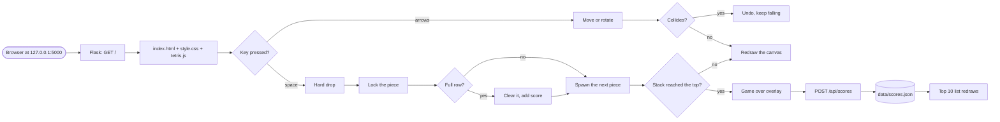

# Tetris — a small game site

## Flask serves one page, and the game itself is plain JavaScript on a canvas

> **▶ Play it:** <>
>
> The server has to be running first. **In VS Code, press `Ctrl+Shift+B`** and it
> starts the server *and* opens the page for you — see
> [Open it from VS Code](#open-it-from-vs-code).
> In the Markdown preview, follow the link with **`Ctrl` + click**.

- **Python + Flask** — one route for the page, two routes for the score board
- **JavaScript, no framework** — the board, the pieces and the game loop, ~400 lines, no build step
- **HTML5 canvas** — the board and the next-piece preview are drawn, not images
- **CSS** — dark panel look, and one column on a phone with on-screen buttons
- **A JSON file** — the leaderboard, no database for version 1
- **Markdown + Mermaid** — this README, including the diagram below
- **GitHub** — one folder, uploaded to my fork

---

### Mermaid

What happens from a key press to a saved score:



### Python

The only piece of Python the browser talks to is the score route. It validates
the payload, keeps the list sorted, and writes the file in one step:

```python
@app.post("/api/scores")
def post_score():
    payload = request.get_json(silent=True) or {}
    try:
        score = int(payload["score"])
        lines = int(payload.get("lines", 0))
        level = int(payload.get("level", 1))
    except (KeyError, TypeError, ValueError):
        return jsonify({"error": "score, lines and level must be integers"}), 400

    if score < 0 or lines < 0 or level < 1:
        return jsonify({"error": "values out of range"}), 400

    name = " ".join(str(payload.get("name", "")).split())[:16] or "Player"
    entry = {"name": name, "score": score, "lines": lines, "level": level,
             "at": datetime.now().strftime("%Y-%m-%d %H:%M")}

    with _lock:
        scores = sorted(load_scores() + [entry],
                        key=lambda row: row["score"], reverse=True)[:10]
        save_scores(scores)

    return jsonify({"ok": True, "scores": scores}), 201
```

## The idea

The class list of prompts had ten one-word options. Number three was
**PLAY THE GAME**, so I picked it and built a game that runs in the browser
instead of on the desktop — the same page works on my laptop and on my phone,
and nothing has to be installed on the other side.

Tetris is the right size for one class: the rules fit on a postcard, but a real
version still needs a grid, collision checks, rotation with wall kicks, a
scoring table, and a place to keep the scores. Every one of those is a small
piece I can finish and then explain.

It also fits where I want to go after graduation. The front end is deliberately
boring (canvas and `requestAnimationFrame`, no framework), because I want to be
able to say exactly what every line does. The back end is Flask, which is the
part of this project I actually want to learn.

## Screenshots

Opening the link — the piece falling, the faint *ghost* showing where it will
land, and the next piece on the right:


After stacking pieces until the board filled up — the score was posted to the
server and the top 10 redrew without a page reload:


## Open it from VS Code

Everything needed is already in `.vscode/`, so the editor can start the server
and open the page without a terminal.

**Step one: open the folder, not only the file.** `File → Open Folder…` and pick
`DSC-202384014045-Tetris`. VS Code only loads tasks and debug configurations when
a folder is the workspace — with a single `README.md` open, `Ctrl+Shift+B` has
nothing to run.

Then pick one:

1. **`Ctrl+Shift+B`** — the default build task runs `run.bat`: Flask starts on
   port 5000 and the browser opens <http://127.0.0.1:5000>.
2. **`F5`** — starts `app.py` under the debugger and opens the page as soon as
   the server logs "Running on …". Breakpoints in `app.py` work.
3. **`Ctrl+Shift+P` → `Tasks: Run Task`** — `▶ Play Tetris`,
   `Start server only`, `Stop server (free port 5000)`, `Install Flask`.

Two things that catch people out:

- In the Markdown preview a plain click does nothing — follow a link with
  **`Ctrl` + click**, or copy the address into the browser.
- If the terminal inside VS Code says `python` is not recognised, close the
  window and open it again: a VS Code started before Python was installed keeps
  the old `PATH`.

## How to run

Needs Python 3.10 or newer.

```bash
python -m pip install -r requirements.txt
python app.py
```

Then open <http://127.0.0.1:5000>.

On Windows you can skip the terminal and just **double-click `run.bat`** — it
installs Flask the first time, starts the server, and opens the page for you.

### Controls

| Key | Action |
| --- | ------ |
| `←` `→` | move left / right |
| `↑` | rotate (with a small wall kick) |
| `↓` | soft drop, +1 point per row |
| `space` | hard drop, +2 points per row |
| `P` | pause |
| `R` | restart |

On a phone the same five actions are on-screen buttons under the board.

## What is inside

| File | What it does |
| --- | --- |
| `app.py` | Flask app: the page, the score API, and the health check |
| `static/tetris.js` | the game — pure logic on top, canvas drawing at the bottom |
| `static/style.css` | the layout and the colours |
| `templates/index.html` | the page skeleton (canvas, panel, leaderboard) |
| `run.bat` | double-click launcher for Windows |
| `.vscode/tasks.json` | `Ctrl+Shift+B` starts the server and opens the page |
| `.vscode/launch.json` | `F5` debugs Flask and opens the page when it is ready |
| `data/scores.json` | the leaderboard, created on the first saved score |

```text
tetris-game/
├── app.py
├── run.bat
├── requirements.txt
├── README.md
├── .vscode/               <- Ctrl+Shift+B plays, F5 debugs
│   ├── tasks.json
│   ├── launch.json
│   └── extensions.json
├── data/                  <- scores.json appears after the first game
├── docs/
│   ├── opening.png
│   └── gameover.png
├── static/
│   ├── style.css
│   └── tetris.js
└── templates/
    └── index.html
```

## What I checked

| Check | Result |
| --- | --- |
| Page and assets | `/` returns 200, plus `style.css` and `tetris.js` |
| Health endpoint | `/api/health` answers `{"status": "ok"}` |
| Saving a score | `POST /api/scores` returns 201 and the new rank |
| Bad input | negative or missing score → 400, not a crash |
| Leaving it empty | board starts empty, "No scores yet" instead of an error |
| Rotate, collide, clear | 10 unit tests of the pure logic all pass |
| Keyboard | hard drops stack pieces on the board, score goes up |
| Game over | overlay appears, the score is posted, the list redraws |
| No console errors | checked while playing the page in the browser |

## Scope

**In, and already working in this version:**

1. one page at `http://127.0.0.1:5000`, nothing to install on the player's side
2. the seven tetrominoes, rotation, and a five-offset wall kick
3. a faint ghost piece showing where the current piece will land
4. score, lines and level, with the fall speed rising every ten lines
5. pause and restart, with the overlay
6. a top-10 leaderboard that survives a restart, because the server keeps it
7. on-screen buttons, so the same page works on a phone

**Out, for version 1:**

- sound and music
- a *hold* slot and a three-piece preview
- a real database (the leaderboard is one JSON file)
- accounts and logins — the player types a name, nothing is verified
- a proper SRS wall-kick table; the current kick tries five sideways offsets

## Next steps

- [ ] a small test page for the game loop timing
- [ ] remember the player name in `localStorage`
- [ ] move the leaderboard from JSON to SQLite
- [ ] a "beautiful" mode with a nicer block style
- [ ] put it on a free host so the link works without my laptop

---

Author: **Victor**, student ID **202384014045** — C-Shaanxi 2026-2027 · SCP
Built with Python 3.14.10, Flask 3.1.3 and VS Code.
